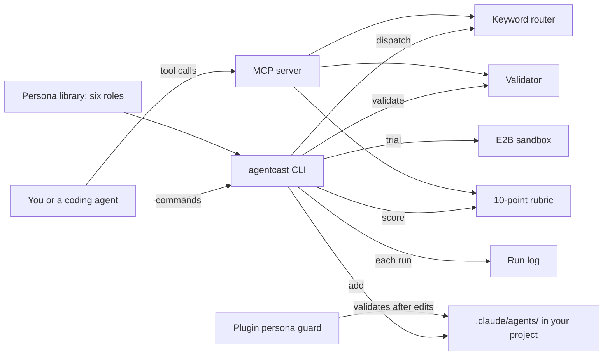

# How AgentCast works

AgentCast is a library of reusable sub-agent personas for Claude Code, with tools that validate, score and pick them.
A persona is a Markdown file with YAML front matter that Claude Code loads as a sub-agent.
A sub-agent is a helper agent with its own prompt and its own list of tools.
AgentCast checks each persona against the fields Claude Code reads, scores it on a rubric, and routes a task to the right one.
It is for people and coding agents who want a ready, checked helper for a common role.

## The parts

The six personas live in [library/](../library/): architect, code reviewer, QA tester, researcher, security reviewer and test writer.
The CLI is [bin/agentcast.mjs](../bin/agentcast.mjs).
[validator/validate.mjs](../validator/validate.mjs) checks a persona against the front matter Claude Code reads.
[eval/eval.mjs](../eval/eval.mjs) scores a persona on a 10-point rubric, and 7 passes.
[dispatch/dispatch.mjs](../dispatch/dispatch.mjs) picks a persona for a task by matching keywords.

[lib/trial.mjs](../lib/trial.mjs) lists what a persona can do: its tools, its permission mode and any commands it carries in `hooks` or `mcpServers`.
With `--sandbox=e2b`, it runs those commands inside an E2B sandbox, a short-lived virtual machine.
[sandbox/persona-sandbox.md](../sandbox/persona-sandbox.md) shows how to try a persona in a scratch project first.
[mcp/server.mjs](../mcp/server.mjs) offers four tools over MCP, the Model Context Protocol that agents use to call tools.
The tools are `persona_dispatch`, `persona_get`, `persona_validate` and `persona_score`.
The plugin hook [hooks/persona-guard.mjs](../hooks/persona-guard.mjs) validates a persona right after an agent writes it.
[observability/run-log.mjs](../observability/run-log.mjs) appends each command to `observability/runs.jsonl`.
[lib/recall.mjs](../lib/recall.mjs) searches AgentCast's own notes, library and skills for `agentcast recall`.

## What happens when you run it

The main flow is `agentcast dispatch "<task>"`, then `agentcast add <id>`.

1. [bin/agentcast.mjs](../bin/agentcast.mjs) reads the command.
2. `dispatch` calls [dispatch/dispatch.mjs](../dispatch/dispatch.mjs). Each persona has a keyword list in `PERSONAS`, and the one with the most hits in the task wins. With no match, it suggests the researcher persona and exits with code 1.
3. `add <id>` copies `library/<id>.md` into `.claude/agents/` in your project, or into `--dir`. It refuses to replace an existing file unless you pass `--force`.
4. It validates the copy with `validateFile` in [validator/validate.mjs](../validator/validate.mjs). The file must sit in `.claude/agents/`, with no nested `agents/agents/` folder.
5. The front matter needs `name` and `description`. The name must not contain a colon or start with a dash, and it holds at most 256 characters.
6. The tool list must use the `tools` key. Claude Code ignores `allowed-tools` in a sub-agent, so such a persona would silently get every tool.
7. Values for `model`, `permissionMode`, `memory`, `effort`, `isolation`, `color` and `background` must be ones Claude Code accepts.
8. It logs the run, prints any problems and exits with code 0 when the persona is valid.

`agentcast score` rates five things, each worth up to 2 points.
They are complete front matter, a model left to the session, a short tool list, an output format and a read-only guard.

## Extending it

- **A new persona.** Add `library/<id>.md` with a name, a description, a short `tools` list and an output format. A read-only persona should say DO NOT MODIFY. Then add an entry with keywords to `PERSONAS` in [dispatch/dispatch.mjs](../dispatch/dispatch.mjs) and routing cases to [eval/golden.json](../eval/golden.json). [skills/persona-scaffold/SKILL.md](../skills/persona-scaffold/SKILL.md) walks through it.
- **A new front matter field or value.** Update `KNOWN_FIELDS` or `ENUMS` in [validator/validate.mjs](../validator/validate.mjs). Add a validator case to [eval/golden.json](../eval/golden.json).
- **A new rubric dimension.** Add it to `evalContent` in [eval/eval.mjs](../eval/eval.mjs).
- **A new MCP tool.** Add it to `TOOLS` and to `callTool` in [mcp/server.mjs](../mcp/server.mjs), with a test in [tests/](../tests/).
- **A new command.** Add a branch to `run` and a line to `HELP` in [bin/agentcast.mjs](../bin/agentcast.mjs).

Then run `npm test`, `npm run validate` and `npm run eval`.

## Questions

**Does it need an API key or cost money?**
AgentCast is free and MIT licensed.
The validator, the rubric and the router call no model and run in under a second.
Only `agentcast trial --sandbox=e2b` needs a key, `E2B_API_KEY`, plus the optional `e2b` package.
E2B is a paid service.

**Does any data leave the machine?**
Only with `trial --sandbox=e2b`, which writes the persona file into an E2B sandbox and runs its commands there.
The sandbox is deleted afterwards.
The run log stays in `observability/runs.jsonl` inside the package folder.

**How does it improve itself?**
[dsip.json](../dsip.json) names no level.
It lists the steps review, extract, prioritize, validate and ship, and one outside source: Claude Code's sub-agent documentation.
Every night [.github/workflows/improve.yml](../.github/workflows/improve.yml) runs the tests and the evals.
Then [scripts/field-drift.mjs](../scripts/field-drift.mjs) compares `KNOWN_FIELDS` with the field table in that documentation.
If the two disagree, the workflow opens an issue with a proposed change, and a person merges it.

**How do I run its tests or evals?**
`npm test` runs [tests/](../tests/) with the test runner built into Node.
`npm run validate` checks every library persona.
`npm run eval` scores every persona, then [eval/golden.mjs](../eval/golden.mjs) checks the validator and routing cases in [eval/golden.json](../eval/golden.json).
Routing must reach 90 percent accuracy.
The live sandbox test in [tests/e2b.test.mjs](../tests/e2b.test.mjs) runs only when `AGENTCAST_LIVE_E2B=1` and `E2B_API_KEY` are set.

**What does it not do?**
It does not run a persona on a real task or judge its advice.
The rubric checks structure, and the router matches keywords, not meaning.
It is not published to npm.
You run it from GitHub with `npx -y -p github:naman10parikh/agentcast agentcast`.
